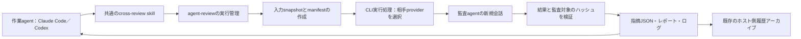

# エージェント相互監査システムの設計

状態：設計案。作成日：2026-10-20。対象：`my-env/one-node-slurm-agents-capsule`。
本書は実装方針を提案するものであり、この設計書の追加によって監査機能やruntimeの動作が有効になるわけではない。

## 採用する方針

共通のCLI実行処理を土台として、コンテナ内コマンド`agent-review`と、共通skill`cross-review`を一つずつ追加する。Claude Codeの作業はCodexに、Codexの作業はClaude Codeに監査させる。既存CLIのログイン情報と、現在のSlurm allocationを利用する。

初期版では、コードと研究成果物の静的な確認を同期実行する。監査agentは指摘を返し、作業agentが対応を判断する。テストの独立実行や、監査通過をjob完了の必須条件にする機能は、実行条件と合格条件を明示したうえで後段に追加する。

## 現在の実装との接続点

- `runtime/agentrun/agentrun`は、選択されたagentのCLI導入と認証情報の準備だけを行う。共通skillsのmountと、会話を永続化するための準備は既にある。
- `review`と`multi-review`のprofileは、出力ファイルとプロンプトに渡す情報を定義している。他のCLIを起動する処理はない。また、現在の`read_only_workspace`ポリシーは、ランチャーの`/workspace`への読み書き可能なbindを変更しない。
- `install-agent.sh`は、渡されたrun directoryごとにCLIのメタデータを一つ書く。親runのdirectoryを渡して再実行すると、作業agentのメタデータを上書きしてしまう。
- 共通hookは`/runs/live`と`/runs/artifacts`へ書き込む。監査agentには、作業agentの通常のhook設定や出力先を引き継がせない。
- `history_export.py`は、現在は親のmanifestにあるagent名に応じてparserを選び、そのagentの履歴directoryを走査する。別providerの監査会話を残すには、監査agentの履歴を明示的に検出する処理が必要になる。

既定agent、共通の研究用skills、イメージの内容、認証ストアの場所、作業agentのセッション保存先、集約先`~/.agentrun/history/`は維持する。

## 全体構成



実行管理処理は、現在のコンテナ内のローカル子processとして動かす。`agentrun`の再呼び出し、repository lockの再取得、新しいSlurm jobの投入は行わない。repository lockは親が既に保持している。初期版ではrunごとに同時実行する監査を一つに制限し、process groupに実行時間の上限を設け、監査結果を受け取ってから作業を再開する。

監査agentが実行管理処理を経由して、さらに監査を依頼することは禁止する。各監査は新規会話とし、`--continue`、`--last`、作業agentのセッションIDは使用しない。

CLI実行処理は、導入済みCLIの取得、役割ごとの設定分離、環境変数の構築、process監視、出力の解釈、CLI固有の会話IDの取得を担当する。実行管理処理は、対象範囲の取得、プロンプトの構築、指摘の検証、結果の失効判定、監査記録を担当する。確定的に実行すべき処理はruntimeのコードに実装し、skillを読むagentが毎回組み立て直す方式にはしない。

この分離は、協調して動く研究用agentのprocessとtoolを分けるためのものである。同じユーザーとして動く二つのprocessについて、互いの認証情報へのアクセスや記録の変更を完全に防ぐものではない。その保証が必要になった場合は、OSまたはコンテナの境界による分離を追加する。

## 提案するインターフェース

以下は利用イメージであり、本設計書によって導入済みになるコマンドではない。

```bash
agent-review run --kind research --brief /runs/artifacts/review-brief.md \
  --base <commit> --include /runs/artifacts/report.md \
  --include /runs/artifacts/metrics.json

agent-review run --kind code --brief /runs/artifacts/review-brief.md \
  --base <commit>

agent-review status <review-id>
```

runtimeが`primary_agent`を記録し、相手agentを自動選択する。監査に使うmodelと推論の強度はproviderごとに設定可能とする。実際に使ったmodelがCLIから取得できる場合は記録し、取得できないメタデータは推測せず不明として扱う。相手agentが使えない場合に、作業agent自身へ黙って切り替えることはしない。

監査依頼書には、目的、検証したい主張、合格条件、関係するデータと手法、依頼する監査範囲、既知の制約を記載する。提供された論文やログも参照できる。作業agent自身の説明は「主張」として渡し、作業の正しさを裏づける証拠としては扱わない。

コマンドが正常に完了した場合は、監査ID、実行状態、判定、結果を適用できるかどうかの状態、指摘ファイルの場所、レポートの場所を返す。監査処理の完了と承認は区別する。子processが非ゼロで終了したことも、研究内容に問題があるという判定とは区別する。

## 両CLIと認証の準備

1. 起動時に作業agentと監査を担当する相手agentを決める。既存のホスト側認証ストア・import処理を利用して、利用可能な両方の認証情報を準備する。認証情報の値を含まない準備状態の記録を残す。相手側の認証がない場合も通常の作業は開始できるが、監査を依頼した際には認証不足による失敗を明示する。
2. 作業agentのCLI導入方式は維持する。相手CLIは最初の監査時にrunあたり一度だけ導入し、その後の監査でも同じ実体を再利用する。installerには専用のrun相当directoryとcache領域を渡し、作業agentの`agent-cli.json`や導入ログを上書きさせない。
3. 監査agentには、既存の一時run HOME配下に専用HOMEを用意する。例は`/home/sandbox/.reviewer/<peer>/`である。このHOMEはrun中維持し、更新された相手側認証情報を次の監査でも利用できるようにする。各監査の会話は毎回新しく開始する。Codexの状態・SQLiteとClaudeの設定は作業agentから分離する。認証情報のコピーはすべて既存のHOME削除処理の対象にする。
4. CLIを遅延導入する場合も、監査履歴を永続化するmountはコンテナ起動前に準備する。例えば既存セッションストアの`reviewers/`配下を使い、監査IDとCLI固有のセッションIDの対応を記録する。scratchへの出力は監査ごとに分ける。
5. 子processの環境変数は明示的に構築する。親のセッション識別子や委譲に関する識別子を除き、役割専用の設定を読み込み、そのproviderに必要な基盤・認証・ネットワーク設定だけを引き継ぐ。CLIの入れ子起動に関係する環境変数も含め、両方向の起動をコンテナ内で検証する。

既にOAuth・サブスクリプションでログインしている場合は、その認証を利用する。API認証も、従来の選択可能な認証方式として残す。Claudeのbare modeは、現在のCLIではサブスクリプションのOAuthを使わないため、起動高速化を目的として採用しない。[Claudeのプログラム実行に関する公式資料](https://code.claude.com/docs/en/headless)を参照する。

認証ファイルはwrapperが取り扱い、modelには読み書きさせない。認証情報を監査プロンプト、snapshot、通常の結果記録、書き出す会話履歴に含めない。

## 監査agentの実行方式と権限

| Provider | 起動と結果の取得 | 初期版の監査権限 |
| --- | --- | --- |
| Codex | 非対話の`codex exec`、構造化した最終回答、JSONイベントログ、新規のCLI固有thread | 読み取り専用sandbox、監査専用設定、snapshotの参照。sandboxを迂回する設定へ自動で切り替えない |
| Claude Code | 非対話のprint実行、JSON Schemaに沿った出力、新規のCLI固有session、最終結果を格納する応答JSON | 読み取り・検索toolを明示した制限付き実行、専用設定、既存MCP serverを引き継がない構成 |

両CLIともschemaで制約した出力に対応するが、最終結果を包む応答の形式は異なる。CLI実行処理で共通形式へ変換してから、実行管理処理で検証する。[OpenAIの非対話実行](https://learn.chatgpt.com/docs/non-interactive-mode)と[Claudeのプログラム実行](https://code.claude.com/docs/en/headless)を参照する。

Claudeの利用可能toolは`--tools`で制限する。許可toolの指定だけでは、指定外toolを利用不可にはできない。読み取り・検索用tool、制限付き実行、明示的に空にしたMCP設定を組み合わせる。詳細は[ClaudeのCLIリファレンス](https://code.claude.com/docs/en/cli-reference)を参照する。

作業agentの権限確認を迂回するflag、自動整形hook、branch・worktree作成hook、Stop通知、共通状態ファイルへの書き込み、自動memory、監査の自動委譲は引き継がない。必要なproject・研究分野の規約は監査用の文脈として渡し、project独自の処理を実行させない。agentの設定や指示ファイル自体が監査対象の場合は、それらを自動設定・hook・skillの探索対象にならない場所へ、確認用の資料として保存する。

監査agentは基本的にsnapshotを読み、結果を標準出力へ返す。レポートと状態ファイルは実行管理処理が書き、監査agentには親の出力契約に属するファイルを更新させない。Codexのファイル出力を使う場合は、CLI実行処理を通じて監査専用の出力先だけに書く。sandboxや制限付き実行が起動できない場合は、無制限の実行へ切り替えず失敗を返す。

初期版の監査では、学習、任意のshell command、テスト、GitHubへの書き込み、修正を実行しない。Codexはsandbox内で確認用commandを使い、Claudeは用意された差分とsourceをファイルtoolで確認する。必要な確認ができない場合は、確認範囲の制約を結果に明記する。toolの制御と入力ハッシュの検証を併用する。snapshotをコピーするだけでは、元のworkspaceへの書き込みを防げない。

## 監査対象を実際の作業内容に結びつける

レポートには、何を確認したのかを正確に記録する。作業agentがセッション中にコミットした変更も対象に含める。

- 作業agentが実際に実行を開始した時点のGit HEADと、未コミット変更の状態を記録する。終了時の`HEAD`を作業開始時のコミットとみなさない。
- 指定された比較元を、取得前に固定のコミットへ解決する。現在の追跡対象ファイル、比較元との差分を新たに生成したバイナリ対応patch、明示的に選ばれた未追跡コード・成果物を取得する。stage済み・未stageの状態も記録する。ユーザーが元から持っていた変更はそのように示し、作業agentが作成したものと断定しない。
- 選択した資料を監査ごとの入力directoryへ固定する。`manifest.json`には、比較元、確認時のHEAD、ファイルのパスとハッシュ、不足・削除されたファイル、容量制限、除外対象、成果物のハッシュ、依存関係・データの由来を記録する。
- 変更の理解に必要なlockfile、設定、選択した証拠を含める。大きなデータセットは、小さな抜粋を明示的に選んだ場合を除き、識別子とハッシュで参照する。run cache、履歴ストア全体、秘密情報ファイル、外部を指すsymlinkの参照先、任意のデータdirectory全体を再帰的にコピーしない。
- 取得中の変更を検出し、失敗させるか、回数・時間を制限した取得方針の範囲で再試行する。複数時点の内容が混在すると分かっているsnapshotを、固定済みの入力として扱わない。省略や未対応のバイナリ・視覚資料を明示し、黙って切り詰めて監査を通過させない。
- 正規化したmanifestと取得した内容から、監査対象を識別するハッシュを計算する。監査終了時に、現在の対象資料を取得時のハッシュと比較する。入力が変わっていれば、その結果は失効扱いにする。監査結果を完了条件として使うたびにも同じ確認を行い、過去の承認を後の編集へ流用しない。

初期版の同期監査中は、作業agentを待機させる。これで変更の混入は減るが、agentが協調して動くことをハッシュ検証の代わりにはしない。再監査には新しいID、snapshot、結果を用意し、以前の指摘も残す。

## 結果と状態の契約

監査の実行記録は`/runs/reviews/<review-id>/`へ保存する。

```text
request.json            対象範囲、作業・監査agentのID、制限、親との対応
input/manifest.json     sourceの識別情報とハッシュ
input/source/           選択したsourceのsnapshot
input/artifacts/        選択した証拠のsnapshot
input/diff.patch        生成した変更差分
runtime/                相手CLIの導入・version情報と役割専用の診断記録
live/status.json        実行状態、終了コード、時刻・所要時間、エラー
stdout.jsonl            providerが出力するイベントログ（取得可能な場合）
stderr.log              CLI・runtimeの診断ログ
review_findings.json    検証に通った指摘だけを格納するJSON
report.md               指摘JSONから確定的に生成する可読レポート
response.json           作業agentの回答と、後続の再監査への対応
```

認証情報、および認証情報を含むHOME内のファイルは、この記録領域の外へ置く。

以下の三つを独立して扱う。

| 概念 | 値・意味 |
| --- | --- |
| 実行状態 | prepared、running、success、failed、cancelled、timeout |
| 監査判定 | 既存の`approve`、`request_changes`、`comment`。実行失敗時は判定を持たせない |
| 結果の適用可否 | 現在の対象に有効、対象が変わったため失効、依頼範囲の確認が不十分 |

既存の`reviews/review_findings.json`の形式を互換性の基準とする。基本項目は`summary`、`verdict`、`findings`であり、指摘には重要度、パス・行番号、説明、修正案を含める。これにschemaのversion、監査ID・対象ID、実際の監査agentの情報、確認済み範囲、制約、証拠への参照を追加する。

各指摘では、観測した事実と仮説を区別する。確信度を記録し、証拠を独立実行で確認したのか、提供されたログを読んだだけなのかを明示する。参照先はmanifest内で解決できるものに限定する。実行管理処理はJSONの構文だけでなく、参照パスとその範囲も検証する。

正常なJSONが返り、終了コードが0であることだけでは合格としない。想定した対象ID、providerからの正常な最終応答、schemaへの適合、有効な証拠参照、確認範囲の開示を必要条件とする。応答拒否、認証・rate limitの失敗、最終応答の欠落、タイムアウト、不正な出力は区別して記録する。解析に失敗した際に、空の指摘一覧や承認を生成してはならない。

必要な確認が不十分な場合、完了を承認する結果は出せない。`approve`には依頼された範囲を十分に確認したことを要求するが、研究のあらゆる側面を保証する意味にはしない。エラーと失効した結果も確認できるように残し、再試行では別の記録を作る。

明示的な`review` modeでは、既存の`/runs/reviews/review_findings.json`へ互換形式の最終結果を出力する。各試行の正式な記録は、監査IDごとのdirectoryに変更せず残す。進行中の作業agent自身の`report.md`、`run_title.txt`、状態ファイル、CLI導入メタデータを監査出力で置き換えない。

## 研究向けの監査観点と共通skill

`cross-review` skillには、この実行基盤をいつ、どのように使うかを記載する。

- 相互監査を依頼されたとき、および監査を使う作業手順の中で研究・コードの変更を完了として提示する前の重要な節目に起動する。小さな編集のたびに新しい監査を実行しない。
- 対象範囲、仮説、想定する挙動・主張、既に行った検証、証拠の場所、不確実な点を依頼書にまとめる。どちらの作業agentからも同じ`agent-review`を呼び、providerごとのコマンドをその場で組み立てない。
- source、手法、ログ、表、図、提供された論文に裏づけられた指摘を求める。作業agent自身の説明を検証の代わりとして受け入れない。
- 指摘を吟味し、妥当と判断したものを修正する。異論がある場合は証拠とともに説明する。監査agentが提案したpatchを自動適用しない。
- 重要な修正後は、新しいsnapshotを作り、以前の指摘を参照して再監査する。既定では一つの節目につき監査呼び出しを最大2回とし、それでも残る不一致や証拠不足をユーザーへ報告する。さらに続ける場合は、明示的な継続依頼を受ける。
- 監査agent、監査対象ID、残る指摘、制約、結果の適用可否をユーザーへ報告する。提供されたテストログを、独立に再現したテストとして説明しない。

研究固有の詳細な観点は、skillから参照する資料にまとめる。

1. 目的、実装、述べている結論が一致しているか。
2. 学習・検証・テストの分離が、被験者、group、時間、前処理、特徴選択、model選択の手順を踏まえて保たれているか。
3. 比較手法、ハイパーパラメータ探索、評価条件が公平か。
4. 統計上の単位、反復数、seed、不確実性の区間、多重比較の扱いが主張を支えているか。擬似反復を避けているか。
5. データセットのversion、コード・入力のハッシュ、設定、環境、成果物の由来が、報告した手順の再現に十分か。
6. 表・図・指標が提供された結果と一致するか。裏づけのない因果・一般化の主張や、欠落した否定的結果がないか。
7. 出典資料を参照できる場合、引用は主張を裏づけているか。参照できない場合は、その検証が不完全であると記録する。

## 会話履歴の保存と終了処理

監査agentのCLI固有の会話履歴を、作業agentと分けて永続化する。監査ID、親run・session key、provider、役割、CLI固有のthread・session IDを対応づける。既存のexporterを拡張し、これらの記録を列挙してproviderごとにparserを選ぶ。

親の会話アーカイブには、監査会話と監査結果の要約を、役割が分かる節として追加する。失敗した試行の途中までの記録も含める。監査との対応情報はメタデータに保存し、別のデータベースサービスは導入しない。

既存の集約Markdown・SQLiteへの書き出しは、引き続き起動・job投入側ホストで行う。監査agentの一時HOMEにしかないログは、HOME削除前に永続化する。作業の再開対象は作業agentの会話に限定し、時刻が新しい監査会話を誤って作業再開の対象にしない。

監査の実時間には設定可能な上限を設ける。初期案は10分とする。終了要求後、制限した猶予時間を過ぎたら子process groupを強制停止し、途中までの診断記録を残す。親のセッション確定・履歴書き出しの前に、監査の子processを停止する。

監査は現在のjobに割り当てられたCPU・メモリ・実行時間を使い、新しいallocationや独立したGPU割り当てを取得しない。CLIから取得できるtoken・費用の情報は記録するが、サブスクリプションをまたいで共通に使える金額上限があるとは仮定しない。

## 実装の段階

1. **実行基盤と両方向の起動。** 相手側の準備状態・認証情報の準備、役割専用HOMEと会話の永続化、CLIの遅延導入、権限制限付きの非対話実行処理、実行時間を制限したprocess管理、作業agentと監査agentの出力分離を実装する。
2. **利用可能な監査手順。** snapshotと由来の記録、結果の検証、研究用の参照資料、共通skill、結果の失効判定、指摘への回答記録、既存の集約履歴との連携を実装する。この段階までを初期版とする。
3. **独立した検証と完了時の必須判定。** 使い捨ての検証workspaceで実行管理処理がテストを動かし、計算量の上限を明示する。任意の`--require-review`により、runtime・検証処理で監査を必須化する。必須条件はskillだけでは強制できず、processの終了コードが0であることだけからも判定できない。

既存のreview出力契約を再利用する。初期版のためにAPI SDK、MCP server、新しいSlurm broker、二つ目のイメージは導入しない。

## 実装時に変更するファイルの見込み

- `runtime/agentrun/agent_cli.py`、`review.py`、指摘のschemaを追加する。必要に応じて監査agent専用の設定templateも用意する。
- `common/skills/cross-review/SKILL.md`と、研究監査の参照資料を追加する。
- `agentrun`、`sessions.py`、installerとの接続処理を拡張する。相手の準備状態、起動時点の情報、役割別directory、導入記録の分離を扱う。
- 履歴の検出・書き出しを拡張し、監査会話と監査要約の対応を扱う。
- 新しい監査記録と任意の必須判定に必要な範囲だけ、出力契約の説明を更新する。既存の作業agentのrun契約は維持する。

## 受け入れ確認

まずは偽CLIを使う。起動・実行管理の検証にmodel呼び出しは必要ない。

- Claude Codeの作業agentはCodexを一度呼び、Codexの作業agentはClaude Codeを一度呼ぶ。同じproviderへの代替実行や、監査委譲のループが発生しない。
- 認証情報の不足、導入失敗、未対応flag、rate limit、応答拒否、不正なJSON、タイムアウトを承認として扱わない。
- 対応するtool設定の範囲で、静的監査のtoolから作業agentのファイルを変更できない。sandboxの起動失敗時に無制限実行を有効にしない。
- 監査の開始・終了で、親の成果物、hook、CLIのversion記録、再開する会話の選択、lockが変更されない。
- コミット済み変更、stage済み・未stageの変更、明示的に選んだ未追跡の成果物、作業開始前からの変更、空白を含むパス、除外した入力を扱える。
- snapshot取得中の変更、失効した承認、不正な証拠参照、確認範囲の不足を検出して報告する。
- 関係するprocessとその子孫を設定した時間内に停止し、途中までの監査記録を残しつつ、既存のHOME削除を妨げない。
- 認証情報を含めず、失敗した試行も含めて両providerの会話を集約保存できる。通常の作業再開が維持される。
- その後、明示的に実行する実環境のsmoke testで、実際のApptainerコンテナ内のOAuthログイン、CLI固有の応答形式、sandboxの動作を確認する。

## 参照資料と互換性

modelを呼び出さず、ローカルのCLI helpでCodex 0.162.1とClaude Code 2.1.302を確認した。runごとの導入ではその時点の公開版を取得するため、このversionの組み合わせを前提にせず、導入されたversionと必要flagを確認する。

- [OpenAI：非対話実行](https://learn.chatgpt.com/docs/non-interactive-mode)
- [OpenAI：開発者向けコマンド](https://learn.chatgpt.com/docs/developer-commands?surface=cli)
- [Claude Code：プログラムからの実行](https://code.claude.com/docs/en/headless)
- [Claude Code：CLIリファレンス](https://code.claude.com/docs/en/cli-reference)
