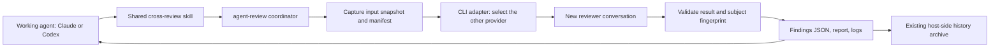

# Cross-agent review design

Status: proposal, 2026-10-20. Scope: `my-env/one-node-slurm-agents-capsule`.
This document proposes an implementation; it does not enable review or change
runtime behavior.

## Decision

Add one capsule command, `agent-review`, backed by a shared CLI adapter, and one
shared `cross-review` skill. Route Claude Code work to Codex and Codex work to
Claude Code. Use the existing CLI logins and the current Slurm allocation.

Start with synchronous inspection of code and research artifacts. The reviewer
returns findings; the working agent decides how to address them. Running tests
independently and requiring a successful audit at job completion are subsequent
capabilities with explicit execution and acceptance contracts.

## Current integration points

- `runtime/agentrun/agentrun` installs and stages credentials for the selected
  agent only. It already mounts shared skills and prepares persistent sessions.
- The `review` and `multi-review` profiles define outputs and prompt fields.
  They do not dispatch other CLIs. Their `read_only_workspace` policy currently
  does not change the launcher's read/write `/workspace` bind.
- `install-agent.sh` writes one CLI metadata file per supplied run directory.
  Calling it again with the parent run directory would overwrite worker metadata.
- Shared hooks write `/runs/live` and `/runs/artifacts`. A reviewer must not load
  the worker's ordinary hook configuration or inherit its output destinations.
- `history_export.py` currently chooses its parser from the parent manifest's
  agent and scans that agent's transcript directories. It needs explicit reviewer
  transcript discovery to retain the other provider's conversations.

Primary defaults, shared research skills, image contents, auth store locations,
primary session paths, and the centralized `~/.agentrun/history/` archive remain.

## Architecture



The coordinator is a local subprocess inside the current capsule. It does not
invoke `agentrun`, request another repository lock, or submit another Slurm job.
The parent already holds the repository lock. Initially allow one active review
per run, use a bounded process group, and wait for the result before work resumes.
Reviewer calls through the coordinator cannot request another review. Fresh
conversations never use `--continue`, `--last`, or a worker session ID.

The adapter owns CLI installation lookup, isolated role configuration, environment
construction, process supervision, output decoding, and native conversation IDs.
The coordinator owns scope capture, prompts, findings validation, stale detection,
and review records. Deterministic mechanics belong in runtime code rather than
being reconstructed by the skill.

This is process and tool separation for a cooperating research workflow. It is
not a claim that two processes running as the same user are mutually isolated
from credentials or unable to alter each other's records. A separate OS/container
boundary is a later option if that guarantee becomes a requirement.

## Proposed interface

Illustrative commands, not commands installed by this proposal:

```bash
agent-review run --kind research --brief /runs/artifacts/review-brief.md \
  --base <commit> --include /runs/artifacts/report.md \
  --include /runs/artifacts/metrics.json

agent-review run --kind code --brief /runs/artifacts/review-brief.md \
  --base <commit>

agent-review status <review-id>
```

The runtime records `primary_agent` and selects its peer automatically. The
reviewer model and effort are configurable per provider; record the actual model
when reported, and mark unavailable metadata as unknown rather than inferring it.
Do not silently substitute the worker when the peer is unavailable.

The brief specifies the objective, intended claims, acceptance criteria, relevant
data and methods, requested audit scope, and known limitations. It may reference
provided papers and logs. The worker's own explanation is labeled as a claim;
it is not treated as evidence that the work is correct.

A successful command returns the review ID, execution state, verdict, applicability
state, findings path, and report path. Review completion does not automatically
mean approval, nor does a nonzero child exit mean scientific rejection.

## Preparing both CLIs and authentication

1. At launch, identify the worker and its peer. Stage available credentials for
   both using the existing host-side auth store/import logic. Keep a readiness
   record without credential values. Missing peer authentication does not prevent
   ordinary work; requesting review returns a clear unavailable-auth failure.
2. Keep worker installation behavior. Install the peer lazily on the first review,
   once per run, and reuse that resolved binary for subsequent rounds. Give its
   installer a separate run-like directory and cache namespace so it cannot
   overwrite the worker's `agent-cli.json` or install log.
3. Give the reviewer a separate role HOME under the existing temporary run HOME,
   for example `/home/sandbox/.reviewer/<peer>/`. Keep that HOME for the run so
   refreshed peer credentials remain usable across rounds. Each round still
   starts a fresh conversation. Isolate Codex state/SQLite and Claude configuration
   from the worker. All credential copies remain under HOME cleanup.
4. Prepare persistent reviewer transcript mounts before container launch, even
   though its CLI is installed lazily. For example, use a `reviewers/` subtree of
   the existing session store, with review-to-native-session ID mappings. Keep
   scratch output separate for each review.
5. Construct the child environment deliberately. Remove parent session and
   delegation identifiers, load the role's configuration, and preserve only the
   infrastructure/auth/network settings needed by that provider. Verify both
   launch directions in the capsule, including nesting-related environment flags.

Use OAuth/subscription login when already configured; API credentials remain an
optional existing authentication mechanism. In particular, do not choose Claude
bare mode for speed: the current CLI's bare mode does not use subscription OAuth.
See [Claude programmatic execution](https://code.claude.com/docs/en/headless).

The wrapper, not the model, handles authentication files. Credentials never enter
review prompts, snapshots, ordinary result records, or exported conversations.

## Reviewer execution and permissions

| Provider | Invocation and result handling | Initial review capabilities |
| --- | --- | --- |
| Codex | Headless `codex exec`, structured final response, JSON event log, new native thread | Read-only sandbox, review-specific configuration, snapshot access; no sandbox bypass fallback |
| Claude Code | Headless print mode, JSON Schema output, fresh native session, structured result envelope | Restricted execution with explicitly selected read/search tools, dedicated settings and no inherited MCP servers |

The CLI families support schema-constrained output, but their result envelopes
are different. Normalize them in the adapter before coordinator validation.
See [OpenAI non-interactive execution](https://learn.chatgpt.com/docs/non-interactive-mode)
and [Claude programmatic execution](https://code.claude.com/docs/en/headless).

For Claude, tool availability must be restricted with `--tools`; an allowed-tools
list alone is not an exclusive tool list. Combine a read/search tool set with
restricted operation and an explicit empty MCP configuration. Consult the
[Claude CLI reference](https://code.claude.com/docs/en/cli-reference).

Do not inherit worker permission-bypass flags, auto-formatting hooks, branch or
worktree creation hooks, Stop notifications, shared status writers, auto-memory,
or automatic review delegation. Preserve relevant project/domain conventions as
review context rather than executing project customization. Store captured agent
configurations and instruction files as inert review material when they themselves
are in scope, outside automatic settings/hooks/skills discovery paths.

The reviewer normally reads the snapshot and emits its result to stdout. The
coordinator writes reports and state files; the reviewer does not update the
parent output contract. Codex's file outputs, if used, are written only through
its adapter to review-owned destinations. If sandbox/restricted execution cannot
start, report failure instead of silently enabling unrestricted execution.

Initial audit does not run training, arbitrary shell commands, tests, GitHub
writes, or fixes. Codex may use sandboxed inspection commands; Claude can inspect
prepared diffs and source with file tools. If a necessary inspection is unavailable,
the result must disclose the coverage limit. Tool controls and input fingerprints
complement one another; snapshot copies alone do not enforce read-only access to
the original workspace.

## Binding review to the actual work

A report must identify exactly what was examined, including changes committed
by the worker during the session.

- Record the worker-start Git HEAD and initial dirty-state metadata at actual
  execution start. Do not assume the final `HEAD` is the task's starting commit.
- Resolve the requested base to an immutable commit before capture. Capture the
  current tracked working files and a freshly generated binary-capable diff
  against that commit, plus explicitly selected untracked code/artifacts.
  Include staged and unstaged state metadata. Label pre-existing user changes
  rather than claiming the worker authored them.
- Freeze the selected material in a per-review input directory. Record the base,
  observed HEAD, file paths and hashes, missing/deleted files, size limits,
  exclusions, artifact hashes, and dependency/data provenance in `manifest.json`.
- Include lockfiles, configurations, and selected evidence needed to interpret
  the change. Large datasets are referenced by identifiers/digests unless small
  excerpts are explicitly selected. Do not recursively copy run caches, entire
  history stores, secret files, external symlink targets, or arbitrary data trees.
- Detect changes during capture and fail or retry within a bounded capture policy.
  Do not knowingly present a mixed snapshot as a stable input. Declare omissions
  and unsupported binary/visual evidence; do not silently truncate to a passing
  review.
- Compute a subject fingerprint over the normalized manifest and captured
  content. On return, compare the current selected material with the captured
  fingerprint. Changed input makes the review stale. Perform the same check
  whenever applying a result as a completion condition; a historical approval
  does not approve later edits.

The worker pauses while the initial synchronous review runs. This reduces drift,
but cooperating-agent behavior is not a substitute for fingerprint validation.
Any later round gets a new ID, snapshot, and result; earlier findings remain.

## Result and state contracts

Use `/runs/reviews/<review-id>/` for local operational records:

```text
request.json            scope, primary/peer IDs, limits, parent linkage
input/manifest.json     source identities and hashes
input/source/           selected source snapshot
input/artifacts/        selected evidence snapshot
input/diff.patch        generated change set
runtime/                peer install/version and role diagnostics
live/status.json        execution state, exit code, timings and error
stdout.jsonl            provider events, where available
stderr.log              CLI/runtime diagnostics
review_findings.json    validated findings only
report.md               deterministic human-readable rendering
response.json           worker responses and links to subsequent review rounds
```

Auth and credential-bearing HOME files are outside this record tree.

Keep three independent concepts:

| Concept | Values or interpretation |
| --- | --- |
| Execution | prepared, running, success, failed, cancelled, timeout |
| Judgment | existing `approve`, `request_changes`, `comment`; absent when execution failed |
| Applicability | current, stale, incomplete scope |

The existing `reviews/review_findings.json` shape remains the compatibility base:
`summary`, `verdict`, and `findings` with severity, path/line, message and suggested
fix. Add a schema version, review/subject IDs, actual reviewer provenance, covered
scope, limitations, and evidence references. Each finding distinguishes observed
facts from hypotheses and records confidence and whether evidence was independently
executed or merely read from supplied logs. References must resolve inside the
manifest; the coordinator validates their paths and bounds, not just JSON syntax.

A valid JSON response with exit code zero is necessary but insufficient. Require
the expected subject ID, a terminal successful provider response, valid schema,
valid evidence references, and a disclosed scope. Refusal, auth/rate-limit failure,
missing terminal result, timeout, and invalid output are distinct failures.
Never manufacture an empty finding list or approval when parsing fails.

Incomplete inspection cannot produce a completion approval. An `approve` result
requires sufficient coverage of the requested scope, not a claim to certify every
possible aspect of the research. Errors and stale results remain visible, and
retrying creates another record.

For explicit `review` mode, publish a final compatibility result at the existing
`/runs/reviews/review_findings.json`. The canonical immutable attempt record stays
in its review-ID directory. An ongoing worker's own `report.md`, `run_title.txt`,
status and install metadata are not replaced by reviewer outputs.

## Research-specific audit and the shared skill

The `cross-review` skill explains when and how to use this infrastructure:

- Trigger when cross-agent review is requested, and at meaningful checkpoints
  before presenting scientific/code changes as completed under the review workflow.
  Do not spend a new review call for every trivial edit.
- Assemble a brief with scope, hypothesis, intended behavior/claims, validation
  already performed, evidence locations, and uncertainties. Invoke the same
  `agent-review` command from either worker; do not hand-roll provider commands.
- Ask for findings supported by source, method, log, table, figure, or provided
  paper evidence. Avoid accepting the worker's own explanation as verification.
- Review the findings critically. Fix accepted issues, and explain contested
  findings with evidence. Never auto-apply the reviewer's suggested patch.
- Re-review material fixes against a new snapshot, referencing earlier findings.
  Default to at most two review calls for one checkpoint before surfacing unresolved
  disagreements or insufficient evidence to the user. Additional rounds require
  an explicit continuation request.
- Report the reviewer, reviewed subject ID, remaining findings, limitations and
  applicability to the user. Do not describe supplied test logs as independently
  reproduced tests.

Put research-specific detail in a linked reference:

1. Objective, implementation, and stated conclusions agree.
2. Train/validation/test separation respects subjects, groups, time, preprocessing,
   feature selection, and model-selection procedures.
3. Baselines, hyperparameter search and evaluation conditions are comparable.
4. Statistical units, replicate counts, seeds, uncertainty intervals and multiple
   comparisons support the reported claim; avoid pseudoreplication.
5. Dataset versions, code/input hashes, configuration, environment, and artifact
   provenance are sufficient to reproduce the reported procedure.
6. Tables/figures/metrics match the supplied results; unsupported causal or
   generalization claims and missing negative results are identified.
7. Citations support the claims when their source material is available. Otherwise
   record that verification is incomplete.

## Recording conversations and lifecycle

Persist reviewer native transcripts separately from the worker, with review ID,
parent run/session key, provider, role, and native thread/session IDs. The current
exporter must enumerate those records and select a parser for each provider.
Append labeled reviewer sections and review summaries to the parent conversation
archive, including partial failed attempts. Store review linkage in its metadata;
no separate database service is needed.

Continue exporting on the launcher/submission host to the existing centralized
Markdown/SQLite store. Reviewer logs that only live in its temporary HOME must be
persisted before that HOME is removed. Keep worker resume selection focused on
worker threads so a newer review cannot become the resumed working conversation.

Use a configurable wall-clock timeout (initial suggestion: 10 minutes), terminate
then forcibly stop the child's process group with a bounded grace period, and
preserve partial diagnostics. Stop children before parent finalization/export.
A review consumes the current job's CPU/memory/time allocation and receives no
new allocation or independent GPU claim. Native token/cost metadata are recorded
when available; a portable monetary limit is not assumed across subscriptions.

## Delivery phases

1. **Runtime foundation and both directions.** Peer readiness/auth staging,
   isolated role homes and transcript persistence, lazy installation, constrained
   headless adapters, bounded processes, and separate worker/reviewer outputs.
2. **Usable audit workflow.** Snapshot/provenance, result validation, research
   reference, shared skill, stale detection, response tracking, and centralized
   history integration. These two phases are the initial useful release.
3. **Independent validation and completion gates.** Controller-run tests in a
   disposable validation workspace, explicit compute limits, and optional
   `--require-review` enforcement in runtime/verification. A hard requirement
   cannot be enforced solely by a skill or inferred from process exit code zero.

Reuse existing review output contracts; do not introduce an API SDK, MCP server,
new Slurm broker, or second image to obtain the initial release.

## Expected files to change when implementation is authorized

- Add `runtime/agentrun/agent_cli.py`, `review.py`, and a findings schema, plus
  explicit reviewer configuration templates where needed.
- Add `common/skills/cross-review/SKILL.md` and a research-audit reference.
- Extend `agentrun`, `sessions.py`, and the installer integration for peer
  readiness, startup provenance, role directories and isolated install records.
- Extend history discovery/export for reviewer transcripts and summary linkage.
- Update output-contract guidance only for the new review records and optional
  enforcement; preserve the current primary-agent run contract.

## Acceptance checks

Use fake CLIs first; no model calls are needed to validate orchestration.

- Claude worker invokes Codex exactly once; Codex worker invokes Claude exactly
  once; no same-provider fallback or delegated review loop.
- Missing credentials, installation failure, unsupported flags, rate limiting,
  refusals, invalid JSON, and timeout never become an approval.
- Static reviewer tools cannot modify worker files through the supported tool
  configuration; sandbox startup failure never enables unrestricted execution.
- Parent outputs, hooks, CLI version record, session choice, and locks are not
  modified by reviewer startup or completion.
- Include committed changes, staged/unstaged changes, explicitly selected
  untracked artifacts, initial dirty state, paths with spaces, and excluded inputs.
- Snapshot drift, stale approval, invalid evidence paths, and missing coverage are
  detected and reported.
- Stop/kill both processes and their descendants within the configured deadline;
  preserve partial review records without preventing existing HOME cleanup.
- Archive both providers' conversations centrally, including failed attempts,
  without exporting credentials; preserve normal worker resume behavior.
- A subsequent opt-in live smoke test verifies real OAuth logins, native CLI
  envelopes and sandbox behavior inside the actual Apptainer capsule.

## Sources and compatibility notes

Checked local CLI help without starting model calls: Codex 0.162.1 and Claude Code
2.1.302. Per-run installation selects current releases, so capability checks must
inspect the installed version and required flags rather than assuming this pair.

- [OpenAI: non-interactive mode](https://learn.chatgpt.com/docs/non-interactive-mode)
- [OpenAI: developer commands](https://learn.chatgpt.com/docs/developer-commands?surface=cli)
- [Claude Code: programmatic execution](https://code.claude.com/docs/en/headless)
- [Claude Code: CLI reference](https://code.claude.com/docs/en/cli-reference)
