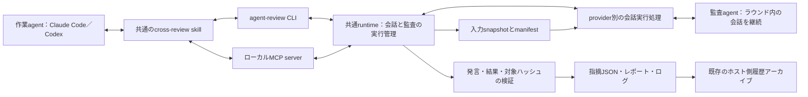
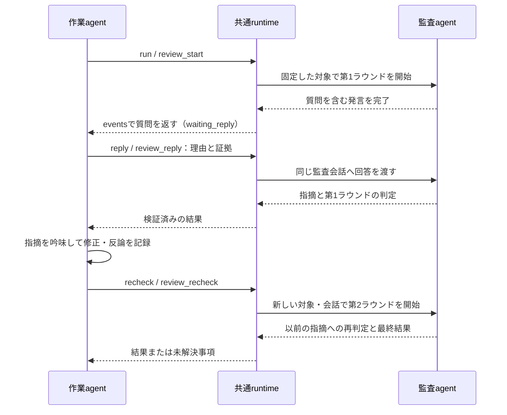

# エージェント相互監査システムの設計

状態：設計案。作成・更新日：2026-10-20。対象：`my-env/one-node-slurm-agents-capsule`。
本書は実装方針を提案するものであり、この設計書の追加によって監査機能やruntimeの動作が有効になるわけではない。

## 採用する方針

会話と監査を管理する共通runtimeを土台として、コンテナ内コマンド`agent-review`、ローカルMCP server、共通skill`cross-review`を追加する。CLIとMCPは同じ操作・状態・記録を使う入口とし、Claude Codeの作業はCodexに、Codexの作業はClaude Codeに監査させる。既存CLIのログイン情報と、現在のSlurm allocationを利用する。

初期版から、コードと研究成果物の静的な確認に加え、監査agentと作業agentの対話を扱う。監査途中の質問・回答、指摘への反論、証拠の追加を、人間が中継せずに受け渡す。既定は対話ありとし、質疑応答を行わない一括実行も明示的に選択できる。初回監査と再監査を合わせて、一つの節目につき最大2ラウンドを既定とする。

本書でいう対話とは、完成した発言を相手へ順に渡し、同じ監査会話を継続することである。人間向けTUIを操作したり、生成途中のtokenをそのまま相手の入力へ流し込んだりする方式ではない。内部で非対話CLIを使っても、会話を継続して複数回発言できれば、この対話を実現できる。

テストの独立実行や、監査通過をjob完了の必須条件にする機能は、実行条件と合格条件を明示したうえで後段に追加する。

## 現在の実装との接続点

- `runtime/agentrun/agentrun`は、選択されたagentのCLI導入と認証情報の準備だけを行う。共通skillsのmountと、会話を永続化するための準備は既にある。
- `review`と`multi-review`のprofileは、出力ファイルとプロンプトに渡す情報を定義している。他のCLIを起動する処理はない。また、現在の`read_only_workspace`ポリシーは、ランチャーの`/workspace`への読み書き可能なbindを変更しない。
- `install-agent.sh`は、渡されたrun directoryごとにCLIのメタデータを一つ書く。親runのdirectoryを渡して再実行すると、作業agentのメタデータを上書きしてしまう。
- 共通hookは`/runs/live`と`/runs/artifacts`へ書き込む。監査agentには、作業agentの通常のhook設定や出力先を引き継がせない。
- `history_export.py`は、現在は親のmanifestにあるagent名に応じてparserを選び、そのagentの履歴directoryを走査する。別providerの監査会話を残すには、監査agentの履歴を明示的に検出する処理が必要になる。

既定agent、共通の研究用skills、イメージの内容、認証ストアの場所、作業agentのセッション保存先、集約先`~/.agentrun/history/`は維持する。

## 全体構成



実行管理処理は、現在のコンテナ内で、ランチャーが管理するrun単位のローカルprocessとして動かす。CLIとstdioのMCP serverは、run専用のUnix socketを介してこれに接続する。接続先はrunの設定で固定し、外部向けの待受portや常設サービスを追加しない。MCPへの接続が切れても、会話の状態をMCP processだけに閉じ込めず、CLIから同じ監査を確認・継続できる。

`agentrun`の再呼び出し、repository lockの再取得、新しいSlurm jobの投入は行わない。repository lockは親が既に保持している。初期版ではrunごとに同時実行する監査を一つに制限する。監査agentが対象を確認している間、作業agentは対象ファイルを編集せず、状態確認と質問への回答を行う。修正は監査結果を受け取った後に行う。

監査agentには監査依頼用MCPや委譲機能を渡さず、さらに監査を依頼することは禁止する。一つの監査ラウンド内では専用の会話IDを保持し、質問への回答はその会話へ送る。再監査は新しいsnapshotと新しい監査会話で開始し、以前の指摘・対話・返答を明示的に渡す。`--continue`、`--last`などによる暗黙の会話選択、および作業agentのセッションIDの流用は禁止する。

provider別の実行処理は、導入済みCLIの取得、役割ごとの設定分離、環境変数の構築、会話の開始・継続・停止、process監視、出力の解釈、CLI固有の会話IDの取得を担当する。実行管理処理は、対象範囲の取得、発言の順序と配送、プロンプトの構築、指摘の検証、結果の失効判定、監査記録を担当する。CLIとMCPにそれぞれ別の会話ロジックを実装しない。確定的に実行すべき処理はruntimeのコードに実装し、skillを読むagentが毎回組み立て直す方式にはしない。

この分離は、協調して動く研究用agentのprocessとtoolを分けるためのものである。同じユーザーとして動く二つのprocessについて、互いの認証情報へのアクセスや記録の変更を完全に防ぐものではない。その保証が必要になった場合は、OSまたはコンテナの境界による分離を追加する。

## 提案するインターフェース

以下は利用イメージであり、本設計書によって導入済みになるコマンドではない。

```bash
# 対話あり。起動要求の受理後は、状態と発言を取得して進める。
agent-review run --request-id <request-id> --kind research --brief /runs/artifacts/review-brief.md \
  --base <commit> --include /runs/artifacts/report.md \
  --include /runs/artifacts/metrics.json

# 質疑応答なしの一括実行。--waitは質問・判定・失敗まで待つ便宜指定。
agent-review run --request-id <request-id> --one-shot --wait --kind code --brief /runs/artifacts/review-brief.md \
  --base <commit>

agent-review status <review-id>
agent-review events <review-id> --after <sequence> --wait-seconds 20
agent-review reply <review-id> --request-id <request-id> --reply-to <message-id> \
  --message-file /runs/artifacts/review-answer.json
agent-review recheck <review-id> --request-id <request-id> \
  --response /runs/artifacts/review-response.json
agent-review cancel <review-id> --request-id <request-id>
```

| 操作 | CLI | MCP tool | 意味 |
| --- | --- | --- | --- |
| 初回監査 | `run` | `review_start` | 監査のまとまりと第1ラウンドを作成する |
| 質問への回答 | `reply` | `review_reply` | 待機中の質問へ回答し、そのラウンドの会話を継続する |
| 修正・反論後の再監査 | `recheck` | `review_recheck` | 前ラウンドへの返答と新しいsnapshotで次ラウンドを作成する |
| 状態確認 | `status` | `review_status` | 実行状態、判定、適用可否、残り予算を読む |
| 発言・進捗の取得 | `events` | `review_events` | sequenceを指定して追加分を取得する |
| 中止 | `cancel` | `review_cancel` | 待機を含めて対象の監査を終了する |

MCP toolの起動・回答・再監査は要求の受理を返し、実際のmodel応答は共通runtimeで進める。イベント取得の待機は1回最大20秒とし、更新がなくても現在の状態とcursorを返す。通知の受信を必須にせず、作業agentは結果を取得して、質問に答えるか、次の更新を待つ。CLIの`--wait`も同じイベント取得を内部で行い、`waiting_reply`になったら質問を返す。回答が必要なままtool呼び出しを占有して、作業agentの発言を妨げない。

変更を伴う要求には呼び出し側で作成した`request_id`（CLIでは`--request-id`）を必須とする。新しい操作には新しいIDを使い、同じ要求の再送は同じ結果を返す。同じIDで内容が異なる要求は拒否する。回答は`reply_to`と対象状態を照合し、古い質問への回答、重複した会話継続、ラウンド数上限の競合を排他制御で防ぐ。CLIとMCPを途中で切り替えても、providerへの送信が重複しない。providerへの送信後に応答を失い、実行の有無を確定できない場合は、その不確実性を記録し、自動で同じ発言を再送しない。

runtimeが`primary_agent`を記録し、相手agentを自動選択する。監査に使うmodelと推論の強度はproviderごとに設定可能とする。実際に使ったmodelがCLIから取得できる場合は記録し、取得できないメタデータは推測せず不明として扱う。相手agentが使えない場合に、作業agent自身へ黙って切り替えることはしない。

監査依頼書には、目的、検証したい主張、合格条件、関係するデータと手法、依頼する監査範囲、既知の制約を記載する。提供された論文やログも参照できる。作業agent自身の説明は「主張」として渡し、作業の正しさを裏づける証拠としては扱わない。

CLIとMCPは、監査のまとまりを表す`review_thread_id`、ラウンドごとの`review_id`、実行状態、待機中の質問、イベントcursor、残り予算を同じ形式で返す。判定が得られた場合は、判定、適用可否、指摘とレポートの場所を追加する。要求の受理、監査処理の完了、承認は区別する。子processが非ゼロで終了したことも、研究内容に問題があるという判定とは区別する。

## 対話の進行と返答の契約



各model発言の出力を`question`または`review_result`として構造化する。`question`には質問ID、質問文、関連する指摘・対象、必要な証拠を含める。実行管理処理は、providerの発言完了とschemaの検証を確認してから`waiting_reply`へ遷移させる。生成途中の文章や内部の推論を、確定した質問や判定として相手へ渡さない。

質問への回答は、質問ID、回答、根拠、証拠への参照を持つ。作業agentは不明・取得不能という回答も返せる。回答には監査agentへの確認質問も付けられ、監査agentは次の発言にその説明を含める。会話に記載された説明と、runtimeが取得した証拠を区別する。追加ファイルが必要な場合は明示的に指定されたものだけを、初期入力と同じパス・symlink・秘密情報・容量の制限で取得し、追記専用manifestへハッシュと由来を記録する。初期snapshotは書き換えず、その内容に変更が必要な場合は現在のラウンドを中止または失効扱いにして、次ラウンドへ移る。

監査agent自身が作業agentへ同期toolを呼び、その間に作業agentが監査結果を待つ構成は採用しない。監査agentは質問で一度発言を完了し、runtimeが質問を返すことで作業agentが応答できるようにする。対話は一度に一つの発言を処理し、相互呼び出しによる再帰や待ち合わせを発生させない。MCPの通知だけで、考慮中の作業agentへ任意の時点で発言を割り込ませられるとは仮定しない。

判定後の作業agentの返答は、指摘ごとの固定`finding_id`に対して、`fixed`（修正した）、`disputed`（反論する）、`deferred`（対応を保留する）を記録し、理由、変更箇所、証拠を付ける。これを`response.json`として確定し、再監査の入力に含める。監査agentは以前の各指摘を、`resolved`（解消）、`withdrawn`（指摘を撤回）、`unresolved`（未解消）、`insufficient_evidence`（証拠不足）で再判定する。作業agentの「対応済み」という宣言だけで解消しない。

再監査は前ラウンドの終了後にのみ開始できる。前ラウンドの指摘・対話・作業agentの返答、新しいsnapshot、前回からの変更差分を渡す。取得対象の指定は前ラウンドから引き継いで現在のファイルを取り直し、追加・除外の指定は明示して記録する。継続した指摘のIDは保持し、新しい指摘には別IDを付ける。新しい対象を、前回の修正箇所だけに限定して承認しない。必要な依頼範囲を確認し、未評価の以前の指摘を黙って消さない。発言の追加は既存の判定を書き換えず、判定後の反論の評価も次ラウンドとして数える。前ラウンドが実行失敗した場合も再実行は次ラウンドとし、失敗の記録を引き継ぐ。指摘が得られていないことを、指摘なしの監査結果と解釈しない。

既定の最大2ラウンドは、初回監査と、その後の修正・反論を評価する再監査を意味する。第1ラウンドで承認されれば終了できる。一つのラウンド内の質疑応答は新しい監査として数えないが、質問と回答の往復にも別の上限を設ける。初期案は1ラウンド最大3往復とし、残り回数を各発言に付ける。上限に達した場合は手元の証拠で判定し、不十分なら承認しない。

ラウンド数は監査のまとまりに永続化し、CLI・MCPの再接続や会話の再作成でリセットしない。provider実行を開始したラウンドは失敗・中止も含めて予算を消費する。開始前の入力不備や認証不足は消費しない。2ラウンド後に残る不一致、実行失敗、証拠不足はユーザーへ報告する。追加実行は明示的な継続依頼によって上限を更新し、履歴に残す。

`--one-shot`では監査agentへ質疑応答なしであることを伝え、入力だけで判定させる。質問が必要な場合は確認不足を明示し、その必要な確認を省略した承認を認めない。対話用の継続機能が利用できないときも、黙って一括実行へ切り替えず、制約を返して明示的な選択を求める。

## 両CLIと認証の準備

1. 起動時に作業agentと監査を担当する相手agentを決める。既存のホスト側認証ストア・import処理を利用して、利用可能な両方の認証情報を準備する。認証情報の値を含まない準備状態の記録を残す。相手側の認証がない場合も通常の作業は開始できるが、監査を依頼した際には認証不足による失敗を明示する。
2. 作業agentのCLI導入方式は維持する。相手CLIは最初の監査時にrunあたり一度だけ導入し、その後の監査でも同じ実体を再利用する。installerには専用のrun相当directoryとcache領域を渡し、作業agentの`agent-cli.json`や導入ログを上書きさせない。
3. 監査agentには、既存の一時run HOME配下に専用HOMEを用意する。例は`/home/sandbox/.reviewer/<peer>/`である。このHOMEはrun中維持し、更新された相手側認証情報を次の監査でも利用できるようにする。ラウンド内では会話を継続し、再監査では新しい会話を開始する。Codexの状態・SQLiteとClaudeの設定は作業agentから分離する。認証情報のコピーはすべて既存のHOME削除処理の対象にする。
4. CLIを遅延導入する場合も、監査履歴を永続化するmountはコンテナ起動前に準備する。例えば既存セッションストアの`reviewers/`配下を使い、監査のまとまり・ラウンドとCLI固有のセッションIDの対応を記録する。scratchへの出力は監査ラウンド・発言ごとに分ける。
5. 子processの環境変数は明示的に構築する。親のセッション識別子や委譲に関する識別子を除き、役割専用の設定を読み込み、そのproviderに必要な基盤・認証・ネットワーク設定だけを引き継ぐ。CLIの入れ子起動に関係する環境変数も含め、両方向の起動をコンテナ内で検証する。
6. 作業agentの設定に、このrun専用の監査MCP serverを登録する。stdio接続のローカルprocessとし、実行管理処理の固定socketを使う。監査agent側には登録しない。CLI経由でも同じruntimeを利用できるため、MCP接続の有無で監査結果や保存場所を変えない。

既にOAuth・サブスクリプションでログインしている場合は、その認証を利用する。API認証も、従来の選択可能な認証方式として残す。Claudeのbare modeは、現在のCLIではサブスクリプションのOAuthを使わないため、起動高速化を目的として採用しない。[Claudeのプログラム実行に関する公式資料](https://code.claude.com/docs/en/headless)を参照する。

認証ファイルはwrapperが取り扱い、modelには読み書きさせない。認証情報を監査プロンプト、snapshot、通常の結果記録、書き出す会話履歴に含めない。

## 監査agentの実行方式と権限

| Provider | 会話の開始・継続と結果の取得 | 初期版の監査権限 |
| --- | --- | --- |
| Codex | 初期の実行処理は`codex exec`で開始し、取得したIDを明示して`codex exec resume <SESSION_ID>`で継続する。構造化した発言とJSONイベントログを取得する | 読み取り専用sandbox、監査専用設定、snapshotの参照。sandboxを迂回する設定へ自動で切り替えない |
| Claude Code | print実行で開始し、取得したIDを明示して`--resume <session-id>`で継続する。JSON Schemaに沿った発言と、応答を格納するJSONを取得する | 読み取り・検索toolを明示した制限付き実行、専用設定、既存MCP serverを引き継がない構成 |

両CLIとも非対話実行での会話継続と構造化した出力に対応するが、発言を包む応答の形式は異なる。provider別の実行処理で共通形式へ変換してから、実行管理処理で検証する。初期版では発言ごとにCLI processが終了してもよく、会話IDと履歴を維持する。すべての継続実行で専用設定・権限・対象の結びつきを再確認し、必要なflagが継続コマンドに対応することも導入versionごとに検証する。[OpenAIの非対話実行](https://learn.chatgpt.com/docs/non-interactive-mode)と[Claudeのプログラム実行](https://code.claude.com/docs/en/headless)を参照する。

実行処理の内部インターフェースは、会話開始、発言送信、イベント取得、中断、終了、機能確認を持つ。後からCodex App ServerやClaudeのstream-json入出力でprocessを維持する方式を追加しても、CLI・MCPの利用方法や監査記録を変えない。これらは逐次イベント取得や起動コストを改善する選択肢とし、初期版の対話を後段の機能へ先送りしない。Codex App Serverの採用可否は、導入時の安定性と認証・権限制御を確認して判断する。[Codex App Server](https://learn.chatgpt.com/docs/app-server)と[ClaudeのCLIリファレンス](https://code.claude.com/docs/en/cli-reference)を参照する。

今回追加するMCP serverは、共通runtimeを作業agentへ公開する専用の入口である。削除済みの`codex mcp-server`には依存しない。また、`claude mcp serve`はClaude Codeのtoolを公開する機能であり、Claudeのmodelとの会話を代行する入口には使わない。既存の認証済みCLIを専用の実行処理から起動する。[Codex MCP serverの削除](https://learn.chatgpt.com/docs/mcp-server)と[Claude CodeをMCP serverとして使う場合の範囲](https://code.claude.com/docs/en/mcp#use-claude-code-as-an-mcp-server)を参照する。

Claudeの利用可能toolは`--tools`で制限する。許可toolの指定だけでは、指定外toolを利用不可にはできない。読み取り・検索用tool、制限付き実行、明示的に空にしたMCP設定を組み合わせる。詳細は[ClaudeのCLIリファレンス](https://code.claude.com/docs/en/cli-reference)を参照する。

作業agentの権限確認を迂回するflag、自動整形hook、branch・worktree作成hook、Stop通知、共通状態ファイルへの書き込み、自動memory、監査の自動委譲は引き継がない。必要なproject・研究分野の規約は監査用の文脈として渡し、project独自の処理を実行させない。agentの設定や指示ファイル自体が監査対象の場合は、それらを自動設定・hook・skillの探索対象にならない場所へ、確認用の資料として保存する。

監査agentは基本的にsnapshotを読み、質問または結果を標準出力へ返す。レポートと状態ファイルは実行管理処理が書き、監査agentには親の出力契約に属するファイルを更新させない。Codexのファイル出力を使う場合は、CLI実行処理を通じて監査専用の出力先だけに書く。会話継続でも同じ権限制限を適用する。sandboxや制限付き実行が起動できない場合は、無制限の実行へ切り替えず失敗を返す。

初期版の監査では、学習、任意のshell command、テスト、GitHubへの書き込み、修正を実行しない。Codexはsandbox内で確認用commandを使い、Claudeは用意された差分とsourceをファイルtoolで確認する。必要な確認ができない場合は、確認範囲の制約を結果に明記する。toolの制御と入力ハッシュの検証を併用する。snapshotをコピーするだけでは、元のworkspaceへの書き込みを防げない。

## 監査対象を実際の作業内容に結びつける

レポートには、何を確認したのかを正確に記録する。作業agentがセッション中にコミットした変更も対象に含める。

- 作業agentが実際に実行を開始した時点のGit HEADと、未コミット変更の状態を記録する。終了時の`HEAD`を作業開始時のコミットとみなさない。
- 指定された比較元を、取得前に固定のコミットへ解決する。現在の追跡対象ファイル、比較元との差分を新たに生成したバイナリ対応patch、明示的に選ばれた未追跡コード・成果物を取得する。stage済み・未stageの状態も記録する。ユーザーが元から持っていた変更はそのように示し、作業agentが作成したものと断定しない。
- 選択した資料を監査ごとの入力directoryへ固定する。`manifest.json`には、比較元、確認時のHEAD、ファイルのパスとハッシュ、不足・削除されたファイル、容量制限、除外対象、成果物のハッシュ、依存関係・データの由来を記録する。
- 変更の理解に必要なlockfile、設定、選択した証拠を含める。大きなデータセットは、小さな抜粋を明示的に選んだ場合を除き、識別子とハッシュで参照する。run cache、履歴ストア全体、秘密情報ファイル、外部を指すsymlinkの参照先、任意のデータdirectory全体を再帰的にコピーしない。
- 取得中の変更を検出し、失敗させるか、回数・時間を制限した取得方針の範囲で再試行する。複数時点の内容が混在すると分かっているsnapshotを、固定済みの入力として扱わない。省略や未対応のバイナリ・視覚資料を明示し、黙って切り詰めて監査を通過させない。
- 正規化した初期manifestと取得した内容から、監査対象を識別するハッシュを計算する。追加証拠は初期の対象ハッシュに結びつけて追記し、判定には使った証拠集合のハッシュも記録する。監査終了時に、現在の対象資料・証拠を取得時のハッシュと比較する。入力が変わっていれば、その結果は失効扱いにする。監査結果を完了条件として使うたびにも同じ確認を行い、過去の承認を後の編集へ流用しない。

対話中も初期snapshotは固定し、作業agentは質問への回答と必要な証拠の提示にとどめる。これで変更の混入は減るが、agentが協調して動くことをハッシュ検証の代わりにはしない。再監査には新しいID、snapshot、結果を用意し、以前の指摘と対話も残す。

## 結果と状態の契約

監査のまとまりには`review_thread_id`を付け、状態とラウンド一覧を`/runs/reviews/threads/<review-thread-id>/`へ保存する。これはprovider固有のthread IDとは別物である。各ラウンドの実行記録は、従来案と同じ`/runs/reviews/<review-id>/`へ保存する。

```text
request.json            対象範囲、役割、review_thread_id、ラウンド番号、前回との対応
input/manifest.json     sourceの識別情報とハッシュ
input/source/           選択したsourceのsnapshot
input/artifacts/        選択した証拠のsnapshot
input/diff.patch        生成した変更差分
input/prior/            前ラウンドの指摘・対話・返答とそのハッシュ
input/supplements/      対話中に追加取得した証拠と追記専用manifest
runtime/                相手CLIの導入・version情報と役割専用の診断記録
live/status.json        実行状態、終了コード、時刻・所要時間、エラー
events.jsonl            発言・配送・状態遷移を順序づけた共通イベントログ
conversation.md         共通イベントから生成する対話の可読記録
turns/<turn-id>/         発言ごとの要求、provider出力、stderr、終了状態
review_findings.json    検証に通った指摘だけを格納するJSON
report.md               指摘JSONから確定的に生成する可読レポート
response.json           判定後に確定した作業agentの返答と、次ラウンドとの対応
```

認証情報、および認証情報を含むHOME内のファイルは、この記録領域の外へ置く。

共通イベントは`sequence`、`message_id`、`request_id`、発言元・宛先の役割、種別、`reply_to`、監査ID・対象ハッシュ、時刻、本文・証拠への参照、provider固有の会話・発言IDを持つ。発言、配送状況、状態遷移をruntimeが追記し、記録を永続化してから受理を通知する。provider固有のIDを取得できない場合は不明として扱う。監査agentの発言を作業agentの発言として記録しない。

MCP serverは同じイベントを返すための入口であり、会話の正式な保存先にはしない。toolの再呼び出しではcursorから追加分を取得できる。接続の切断だけで会話を消したり再作成したりしない。runtime自体が停止した場合は、永続状態とprovider履歴を突き合わせ、未確認の実行は診断可能な失敗状態へ移す。稼働中processの引き継ぎや無条件の再送を前提にしない。

以下の三つを独立して扱う。

| 概念 | 値・意味 |
| --- | --- |
| 実行状態 | prepared、running、waiting_reply、success、failed、cancelled、timeout |
| 監査判定 | 既存の`approve`、`request_changes`、`comment`。実行失敗時は判定を持たせない |
| 結果の適用可否 | 現在の対象に有効、対象が変わったため失効、依頼範囲の確認が不十分 |

`waiting_reply`はラウンドの途中であり、監査の成功でも失敗でもない。質問を出したCLIが正常終了しても、runtimeは監査判定を生成しない。質問への回答を受理すると`running`へ戻る。`review_result`を検証した時点でのみ`success`へ進み、監査判定を確定する。一度確定した判定は対話で上書きせず、次ラウンドの結果で更新する。

既存の`reviews/review_findings.json`の形式を互換性の基準とする。基本項目は`summary`、`verdict`、`findings`であり、指摘には固定`finding_id`、重要度、パス・行番号、説明、修正案を含める。これにschemaのversion、監査のまとまり・ラウンド番号、監査ID・対象ID、証拠集合のハッシュ、実際の監査agentの情報、確認済み範囲、制約、証拠への参照、以前の指摘への再判定を追加する。

各指摘では、観測した事実と仮説を区別する。確信度を記録し、証拠を独立実行で確認したのか、提供されたログを読んだだけなのかを明示する。参照先はmanifest内で解決できるものに限定する。実行管理処理はJSONの構文だけでなく、参照パスとその範囲も検証する。

正常なJSONが返り、終了コードが0であることだけでは合格としない。想定した対象ID、providerからの正常な最終応答、schemaへの適合、有効な証拠参照、確認範囲の開示を必要条件とする。応答拒否、認証・rate limitの失敗、最終応答の欠落、タイムアウト、不正な出力は区別して記録する。解析に失敗した際に、空の指摘一覧や承認を生成してはならない。

必要な確認が不十分な場合、完了を承認する結果は出せない。`approve`には依頼された範囲を十分に確認したことを要求するが、研究のあらゆる側面を保証する意味にはしない。エラーと失効した結果も確認できるように残し、再試行では別の記録を作る。

明示的な`review` modeでは、既存の`/runs/reviews/review_findings.json`へ互換形式の最終結果を出力する。確認中や失敗した再監査に、前ラウンドの承認を最新の承認として残さない。各ラウンドで確定した入力・発言・指摘は書き換えず残す。判定後の`response.json`は受理時に一度確定し、その後の補足は新しい記録として追加する。進行中の作業agent自身の`report.md`、`run_title.txt`、状態ファイル、CLI導入メタデータを監査出力で置き換えない。

## 研究向けの監査観点と共通skill

`cross-review` skillには、この実行基盤をいつ、どのように使うかを記載する。

- 相互監査を依頼されたとき、および監査を使う作業手順の中で研究・コードの変更を完了として提示する前の重要な節目に起動する。小さな編集のたびに新しい監査を実行しない。
- 対象範囲、仮説、想定する挙動・主張、既に行った検証、証拠の場所、不確実な点を依頼書にまとめる。どちらの作業agentからも共通の監査MCP toolを優先して使い、CLIも同じ操作に使えるようにする。providerごとのコマンドをその場で組み立てない。
- イベントを取得して監査途中の質問に答え、固定した対象を編集せずに理由と証拠を渡す。取得できない証拠や不明点も明示する。質問への回答で判定済みの指摘を解消した扱いにしない。
- source、手法、ログ、表、図、提供された論文に裏づけられた指摘を求める。作業agent自身の説明を検証の代わりとして受け入れない。
- 指摘を吟味し、妥当と判断したものを修正する。異論がある場合は証拠とともに説明し、指摘ごとの返答を`response.json`にまとめる。監査agentが提案したpatchを自動適用しない。
- 修正・反論後は、同じ監査のまとまりの中で新しいsnapshotを作り、以前の指摘と返答を渡して再監査する。既定は初回と再監査の最大2ラウンドであり、質疑応答の回数とは区別する。それでも残る不一致や証拠不足をユーザーへ報告する。さらに続ける場合は、明示的な継続依頼を受ける。
- 監査agent、監査対象ID、残る指摘、制約、結果の適用可否をユーザーへ報告する。提供されたテストログを、独立に再現したテストとして説明しない。

研究固有の詳細な観点は、skillから参照する資料にまとめる。

1. 目的、実装、述べている結論が一致しているか。
2. 学習・検証・テストの分離が、被験者、group、時間、前処理、特徴選択、model選択の手順を踏まえて保たれているか。
3. 比較手法、ハイパーパラメータ探索、評価条件が公平か。
4. 統計上の単位、反復数、seed、不確実性の区間、多重比較の扱いが主張を支えているか。擬似反復を避けているか。
5. データセットのversion、コード・入力のハッシュ、設定、環境、成果物の由来が、報告した手順の再現に十分か。
6. 表・図・指標が提供された結果と一致するか。裏づけのない因果・一般化の主張や、欠落した否定的結果がないか。
7. 出典資料を参照できる場合、引用は主張を裏づけているか。参照できない場合は、その検証が不完全であると記録する。

## 会話履歴の保存と終了処理

監査agentのCLI固有の会話履歴を、作業agentと分けて永続化する。監査のまとまり、ラウンド番号、監査ID、親run・session key、provider、役割、CLI固有のthread・session ID、発言IDを対応づける。ラウンド内で継続した同じ会話を重複登録しない。既存のexporterを拡張し、これらの記録を列挙してproviderごとにparserを選ぶ。

親の会話アーカイブには、監査会話と監査結果の要約を、役割が分かる節として追加する。共通イベントによる対話記録も保存し、質問、作業agentの回答、追加証拠、指摘への反論、監査agentの撤回・再判定をたどれるようにする。CLIとMCPのどちらで送った発言も同じ形式で残す。失敗した試行や回答待ちで終了した試行の途中までの記録も含める。監査との対応情報はメタデータに保存し、別のデータベースサービスは導入しない。

既存の集約Markdown・SQLiteへの書き出しは、引き続き起動・job投入側ホストで行う。監査agentの一時HOMEにしかないログは、HOME削除前に永続化する。作業の再開対象は作業agentの会話に限定し、時刻が新しい監査会話を誤って作業再開の対象にしない。

監査agentの実行時間には設定可能な上限を設ける。初期案はラウンド内の全発言を合計して10分とする。質問への回答待ちは別に計測し、1回の回答待ちの期限と、回答待ち・修正時間を含む監査全体の期限も必須とする。初期案はそれぞれ10分・60分とし、jobの残り時間が短ければその範囲へ制限する。接続やCLI processを作り直しても、予算と期限は延長しない。

回答待ちで期限を過ぎた場合は`timeout`にし、未回答の質問を保存する。MCP serverだけが切断した場合は共通runtimeを残してCLIからの再接続を許すが、親の終了時には実行管理処理・MCP server・監査agentの子processをすべて停止する。終了要求後、制限した猶予時間を過ぎたら子process groupを強制停止し、途中までの診断記録を残す。親のセッション確定・履歴書き出しの前に停止と記録の永続化を完了し、既存のHOME削除を妨げない。

監査は現在のjobに割り当てられたCPU・メモリ・実行時間を使い、新しいallocationや独立したGPU割り当てを取得しない。CLIから取得できるtoken・費用の情報は記録するが、サブスクリプションをまたいで共通に使える金額上限があるとは仮定しない。

## 実装の段階

1. **実行基盤と両方向の会話継続。** 相手側の準備状態・認証情報の準備、役割専用HOMEと会話の永続化、CLIの遅延導入、権限制限付きの会話開始・継続・停止、run単位の実行管理、作業agentと監査agentの出力分離を実装する。
2. **CLI・MCPから使える対話監査。** 共通の操作・イベント・状態機械、CLI、stdioのMCP server、質問の中継、追加証拠の取得、返答と指摘の再判定、2ラウンドの上限、期限・重複送信対策を実装する。snapshotと由来の記録、結果の検証、研究用の参照資料、共通skill、失効判定、既存の集約履歴との連携を含める。この段階までを初期版とし、対話機能と両方の入口を受け入れ条件にする。
3. **実行方式の拡充と独立した検証。** 必要に応じて常駐するprovider実行処理を追加する。使い捨ての検証workspaceで実行管理処理がテストを動かし、計算量の上限を明示する。任意の`--require-review`により、runtime・検証処理で監査を必須化する。必須条件はskillだけでは強制できず、processの終了コードが0であることだけからも判定できない。

既存のreview出力契約を再利用する。初期版にローカルMCP serverは含めるが、model APIを直接呼ぶSDK、新しいSlurm broker、二つ目のイメージは導入しない。MCP用依存は専用のuv環境にversionを固定して導入し、既存のcache・導入記録の方針に合わせる。modelとの通信と認証は既存のCLIを使う。

## 実装時に変更するファイルの見込み

- `runtime/agentrun/agent_cli.py`、`review.py`、CLIの入口、MCP server、発言・返答・指摘のschemaを追加する。必要に応じて監査agent専用の設定templateと、MCP用依存の定義も用意する。
- `common/skills/cross-review/SKILL.md`と、研究監査の参照資料を追加する。
- `agentrun`、`sessions.py`、installerとの接続処理を拡張する。相手の準備状態、起動時点の情報、役割別directory、導入記録の分離、作業agentへのMCP登録、実行管理processの起動・終了を扱う。
- 履歴の検出・書き出しを拡張し、監査会話と監査要約の対応を扱う。
- 新しい監査記録と任意の必須判定に必要な範囲だけ、出力契約の説明を更新する。既存の作業agentのrun契約は維持する。

## 受け入れ確認

まずは偽CLIとローカルのMCP clientを使う。起動・実行管理の検証にmodel呼び出しは必要ない。

- Claude Codeの作業agentはCodexに、Codexの作業agentはClaude Codeに監査を依頼できる。両方向で、監査agentの質問、作業agentの回答、同じ監査会話での継続、判定まで進む。同じproviderへの代替実行や、監査委譲のループが発生しない。
- CLIとMCPの各入口で同じ操作・状態・出力を得られる。MCPで開始してCLIで回答する場合、その逆の場合、MCPの切断・再接続でも同じ監査を継続できる。
- 質問が出たらtool呼び出しを終了して作業agentへ制御を返す。質問を出したCLIの終了コード0を、監査成功や承認と取り違えない。待機する相手をさらに同期呼び出しする循環が発生しない。
- 同じ`request_id`の再送、CLIとMCPからの同時回答、古い質問への回答、イベントの再取得でも、同じ発言を二重送信しない。送信後の障害で実行の有無が不明な場合は、自動再送せず記録する。
- 修正、証拠による反論、対応保留を記録できる。再監査には以前の指摘・対話・返答が渡り、すべての以前の指摘について解消・撤回・未解消・証拠不足が報告される。作業agentの自己申告だけで解消しない。
- ラウンド内ではprovider固有の会話IDが維持され、再監査では新しいIDを作る。初回と再監査の計2ラウンド、質疑応答の上限、失敗したラウンドの消費、実行時間と回答待ち期限が、接続やprocessの作り直しでも維持される。
- 認証情報の不足、導入失敗、未対応flag、rate limit、応答拒否、不正なJSON、タイムアウトを承認として扱わない。
- 対応するtool設定の範囲で、静的監査のtoolから作業agentのファイルを変更できない。会話を継続しても設定・権限制限が維持され、監査依頼用MCPが監査agentへ渡らない。sandboxの起動失敗時に無制限実行を有効にしない。
- 監査の開始・終了で、親の成果物、hook、CLIのversion記録、再開する会話の選択、lockが変更されない。
- コミット済み変更、stage済み・未stageの変更、明示的に選んだ未追跡の成果物、作業開始前からの変更、空白を含むパス、除外した入力を扱える。
- snapshot取得中の変更、対話中の元ファイルの編集、追加証拠のハッシュ不一致、失効した承認、不正な証拠参照、確認範囲の不足を検出して報告する。再監査中・失敗時に以前の承認を最新の承認として返さない。
- 一括実行でも同じ結果検証を行い、必要な質疑応答を行えないため確認不足となった場合に承認しない。対話機能が使えない場合、黙って一括実行へ切り替えない。
- 質問待ち・model実行中の両方で中止できる。実行管理process、MCP server、監査agentとその子孫を設定した時間内に停止し、途中までの監査記録を残しつつ、既存のHOME削除を妨げない。
- 認証情報を含めず、失敗・回答待ちで終了した試行も含めて両providerの会話と共通の対話記録を集約保存できる。同じ会話が発言ごとに重複登録されず、通常の作業再開が維持される。
- その後、明示的に実行する実環境のsmoke testで、実際のApptainerコンテナ内のOAuthログイン、CLI固有の応答形式と会話継続、sandbox、MCP登録、両方向の質疑応答・再監査を確認する。

## 参照資料と互換性

当初の設計では、modelを呼び出さず、ローカルのCLI helpでCodex 0.162.1とClaude Code 2.1.302を確認した。今回の更新では公式資料を参照して会話継続とMCPの役割を確認した。実際のCLIによる対話・MCP連携の試験はまだ行っていない。runごとの導入ではその時点の公開版を取得するため、このversionの組み合わせを前提にせず、導入されたversion、継続時に使えるflag、構造化出力・権限制御・認証の機能を確認する。

MCPは作業agentからruntimeへ操作を公開する仕組みであり、providerとの会話方式とは独立させる。この設計上の分離と、ラウンド・返答・期限の契約は本システムの方針であり、各providerがそのまま提供する機能ではない。[MCP tool呼び出しの仕組み](https://developers.openai.com/plugins/concepts/mcp-server)を参照する。

- [OpenAI：非対話実行](https://learn.chatgpt.com/docs/non-interactive-mode)
- [OpenAI：開発者向けコマンド](https://learn.chatgpt.com/docs/developer-commands?surface=cli)
- [OpenAI：Codex App Server](https://learn.chatgpt.com/docs/app-server)
- [OpenAI：旧Codex MCP serverの削除](https://learn.chatgpt.com/docs/mcp-server)
- [OpenAI：MCP serverとtoolの呼び出し](https://developers.openai.com/plugins/concepts/mcp-server)
- [Claude Code：プログラムからの実行](https://code.claude.com/docs/en/headless)
- [Claude Code：CLIリファレンス](https://code.claude.com/docs/en/cli-reference)
- [Claude Code：MCP連携とserverの公開範囲](https://code.claude.com/docs/en/mcp)
